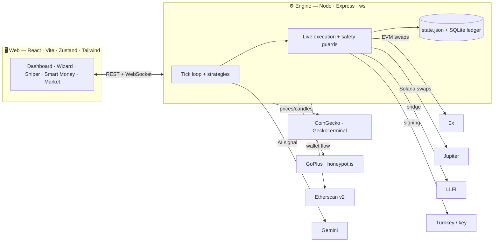

<div align="center">

# ⚡ PulseTrade

### Multi-chain crypto trading bots with a paper-first safety model

Run any number of automated traders — the same coin at several risk tolerances, or many coins at once — each with its own budget, schedule, and independently tracked P&L. Profits are auto-swept to the chain's **native coin** (or **USDT**) so you're never left holding an illiquid bag.


[Quick start](#-quick-start) · [Strategies](#-strategies) · [Features](#-features) · [Going live](#-going-live) · [Safety](#-safety--risk-controls) · [Architecture](#-architecture) · [Docs](DOCS.md)

</div>

---

> [!IMPORTANT]
> PulseTrade starts in **paper mode**: every strategy runs against *real, live market data* with simulated fills (LP fee + slippage + gas included), so you can prove a configuration before risking a cent. Going live is opt-in, fail-closed, and gated behind explicit keys. Backtests are evidence, **not a promise** — see [Honesty](#-honesty).

## 📸 Screenshots

The home view opens on a live **Dashboard** — portfolio equity + trend, paper/live status with the circuit-breaker, capital allocation, automation, and top/bottom performers — then your bots below.

<!-- Add an image at docs/dashboard.png and uncomment:

-->

## 🚀 Quick start

**Prerequisites:** Node **≥ 22.5** (for the built-in `node:sqlite` ledger + the `tsx` test runner). The repo pins it in [`.nvmrc`](.nvmrc).

```bash
nvm use            # → Node 24.15.0 (or any ≥22.5)
npm install
npm run dev        # engine on :8787  +  web app on :5173
```

Open **<http://localhost:5173>**, hit **New Bot**, and follow the wizard — or click **🌤️ One-click All-Weather** for a sensible default. All state persists in `server/data/state.json` (+ an append-only SQLite trade ledger).

```bash
npm test           # 571 tests — see Testing
```

## 🧠 Strategies

The **same `decide()` code** runs in backtests and live trading. Risk tolerance (**Conservative / Balanced / Aggressive**) scales position size, stop-loss, take-profit, grid spacing, RSI thresholds, and cooldowns — launch one coin at two tolerances and compare side by side.

| Strategy | Tagline | Shines in | How it works |
|---|---|---|---|
| 🌤️ **All-Weather** | *Adapts to the regime, defends capital* | Any regime (defensive) | Rides uptrends, mean-reverts ranges, goes to **cash** in downtrends. A fast drawdown-from-peak exit backs up the slower 50h-average regime check. The cautious one-click default — capital-preserving, **not** a profit guarantee. |
| 🪜 **Grid** | *Profits from sideways chop* | Ranging markets | A ladder of buys below an anchor; sells one rung up. |
| 📉 **RSI Mean Reversion** | *Buys fear, sells greed* | Ranges | Buys oversold (RSI < tier), exits overbought / TP / SL; skips confirmed downtrends. |
| 📈 **EMA Momentum** | *Rides confirmed trends* | Trends | Enters on a 9/21 EMA cross up, exits on the reverse cross or stop. |
| 🎚️ **Momentum Factor** | *Buys strength, trails the winners* | Strong trends | Time-series momentum with vol-targeted sizing + an asymmetric trailing ratchet. |
| 💵 **Smart DCA** | *Accumulate dips, exit in profit* | Accumulation | Scheduled slices below the 24h average — with a 50h downtrend filter so it never martingales into a dying token. |
| 🎯 **Sniper** | *Instant entry, take the stake back, ride the runner* | Fresh launches | One-shot entry behind a mandatory safety screen; recovers the stake, then trails the runner. |
| 🐋 **Copy-trade** | *Follow smart money* | — | Mirrors a tracked wallet: buys when they buy, exits when they sell — riding the full move (no take-profit cap). Per-trade size + optional SL/TP; a catastrophic stop guards live copies. |
| 🤖 **AI Trader** | *Gemini decides* | — | Google Gemini reads price action/RSI/MAs → BUY/SELL/HOLD, sized by confidence. |

## 🌐 Networks

Five cheap EVM chains + **Solana** + the **Internet Computer**. One EVM wallet works everywhere. Each chain carries a curated, deep-liquidity token list.

| Network | Live execution | ~Gas / swap | Profit sweep | Notes |
|---|---|---|---|---|
| 🔵 Base | 0x | ~$0.02 | ETH | |
| 🔷 Arbitrum | 0x | ~$0.03 | ETH | |
| 🔴 Optimism | 0x | ~$0.02 | ETH | |
| 🟣 Polygon | 0x | ~$0.01 | POL | |
| 🟡 BNB Chain | 0x | ~$0.10 | BNB | |
| 🌞 Solana | Jupiter | low | SOL | curated: JUP/RAY/BONK/WIF/JTO |
| ♾️ ICP | *paper only* | — | — | KongSwap/ICPSwap are canister-only — live executor pending |
| ⟠ Ethereum | *holdings-only* | high | — | tracked for smart-money + portfolio; mainnet gas makes small bots uneconomical |

*Sniping and wallet tracking are EVM-only.*

## 🧩 Features

<table>
<tr>
<td width="50%" valign="top">

**📊 Dashboard & market**
- At-a-glance **Overview**: equity trend, allocation donut, performers, live-safety status
- Live **Market** view: risk-on/neutral/risk-off pulse (0–100 composite), Fear & Greed, global stats, top-20 with sparklines + transparent BUY/SELL/HOLD signals
- Per-bot equity sparkline, price chart with buy/sell markers, decision log

**🎯 Sniper & Auto-Sniper**
- Safe-only feed: only **verified · sellable · distributed-holder** tokens
- One-shot snipe → TP / SL / trailing / max-hold, sweeps & retires
- **Auto-Sniper**: budget-driven, concurrent vetted snipes, recycles returns

**🐋 Smart money**
- Curated watchlist of documented wallets (GCR, Tetranode, Andrew Kang, Cobie, Vitalik, …) + your own
- **Activity** feed · per-wallet **Accounts** profiles · **consensus accumulation** (majors/stables and dead/stale tokens filtered out)
- Copy a wallet **manually** (one token) or **auto-follow** (mirror every buy)

</td>
<td width="50%" valign="top">

**💡 Profit Finder** — "here's $100, where would it have done best?"
- **Curated**, **Top-100 movers**, and **Trending (safe)** scopes
- Ranked on **out-of-sample** (walk-forward) return with realistic costs; shows the *typical* (median) result beside the best-of-N
- One-click launch of any candidate

**🛡️ Pre-trade screening**
- Every token scored 0–100 via **GoPlus + honeypot.is** (honeypots, non-sellable, rug setups, tax traps, owner controls)
- Hard, no-override block for the Sniper

**🔁 Copy Trading** *(dedicated channel)*
- **Copy-worthiness leaderboard** — every tracked wallet ranked by **true realized P&L** (on-chain cost-basis) when `COINGECKO_API_KEY` is set; net-flow fallback otherwise (shown as a "degraded" hint)
- **Discover** — a background crawl that finds profitable round-trippers of curated tokens you *don't* track yet, verified by realized P&L
- **Guided setup + live preview** — single-token copy *or* auto-follow; per-trade size + optional SL/TP. Copies **mirror** the wallet (exit when they sell); a catastrophic stop auto-guards **live** copies
- Click any wallet for a full analysis — net-flow chart, holdings/allocation, per-token flow, recent trades

**🏆 Extras**
- **Tournaments**: 2–12 bots, equal budget, live leaderboard + podium
- **AI Trader** (Gemini), **Auto-sell to USDT**, **schedules** (24/7 or day/hour windows)
- **Multi-wallet connect** (MetaMask / Coinbase / injected / WalletConnect)
- **Monthly P&L ledger** + filterable trade history
- Native-feeling responsive UI (mobile bottom-nav, bottom-sheet modals, dark/light)

</td>
</tr>
</table>

## 🛰️ Going live

> [!WARNING]
> Live mode moves **real funds**. Use a **dedicated bot wallet** (never your main one), fund it small, and read [AUDIT.md](AUDIT.md) first.

1. Create & fund a dedicated wallet on your target chain.
2. Get a free **[0x API key](https://0x.org/docs)** (EVM).
3. `cp server/.env.example server/.env` and set the keys (below).
4. Restart, then flip the header toggle to **Live**.

| What | Variable(s) |
|---|---|
| EVM routing | `ZEROX_API_KEY` |
| EVM signer | `BOT_WALLET_KEY` *or* Turnkey (`TURNKEY_API_*` + `TURNKEY_EVM_ADDRESS`) |
| Solana signer | `SOLANA_WALLET_KEY` *or* Turnkey Solana |
| Auth (required for live) | `ENGINE_TOKEN` + `VITE_ENGINE_TOKEN` |
| Daily spend cap (required for live) | `MAX_LIVE_USD_PER_DAY` |
| Dedicated RPCs (recommended) | `EVM_RPC_URL_<chainId>`, `SOLANA_RPC_URL` |

EVM trades route native↔token via the 0x allowance-holder API (bounded, route-allowlisted); Solana via Jupiter; cross-chain via LI.FI. Paper accounting continues in parallel.

## 🛡️ Safety & risk controls

PulseTrade went through a multi-agent production-readiness audit ([AUDIT.md](AUDIT.md)); the remediation is tracked in [REMEDIATION.md](REMEDIATION.md). Money-path guards include:

| Guard | What it protects | Configure |
|---|---|---|
| **Fail-closed boot** | Won't arm live without `ENGINE_TOKEN`; binds loopback by default | `ENGINE_TOKEN`, `ENGINE_HOST` |
| **Circuit breaker** | Pauses all live bots on cumulative loss / lifetime spend / drawdown | `MAX_CUMULATIVE_LOSS_USD`, `MAX_LIVE_USD_TOTAL`, `MAX_FLEET_DRAWDOWN_PCT` |
| **Daily spend cap** | Atomic, reserved-before-swap; fail-closed when unset | `MAX_LIVE_USD_PER_DAY` |
| **Exposure caps** | Per-snipe + per-token concentration limits | `MAX_SNIPE_EQUITY_PCT`, `MAX_TOKEN_EXPOSURE_PCT` |
| **Gas reserve** | Always keeps enough native to exit a position | `GAS_RESERVE_MULT` |
| **Bounded approvals** | Exact-amount + 0x AllowanceHolder allowlist (no infinite approvals) | `ZEROX_ALLOWANCE_HOLDER` |
| **Price-impact / slippage** | Aborts thin-pool entries; hard slippage ceiling | `MAX_PRICE_IMPACT_PCT`, `MAX_SLIPPAGE_BPS` |
| **Reconciliation** | Live P&L/positions track the **measured on-chain fill**, not the quote | — |
| **Observability** | `GET /health` (tick age, spend, breaker, providers) + webhook/Telegram alerts | `ALERT_WEBHOOK_URL`, `ALERT_TELEGRAM_*` |
| **Crash-safe** | Graceful drain on SIGTERM + in-flight buy journal recovered on boot | — |

## 🏗️ Architecture



<details>
<summary><b>Module map</b></summary>

```
server/  Express + WebSocket engine (Node ≥22.5, tsx)
  src/engine.ts        tick loop, paper + live executor, sweeps, schedules, safety guards
  src/strategies.ts    every strategy (shared by engine + backtester)
  src/backtest.ts      walk-forward backtests w/ realistic costs + Profit Finder
  src/costs.ts         single source of truth for the cost model (LP fee + slippage)
  src/prices.ts        CoinGecko spot/candles + GeckoTerminal pool pricing, cached + staleness-gated
  src/risk-screen.ts   pure 0–100 risk scorer (rug/honeypot/exploit flags)
  src/screen-fetch.ts  GoPlus + honeypot.is fetch wrapper, cached
  src/sniper.ts        GeckoTerminal new/trending pool discovery + safe-only filter
  src/smartmoney.ts    watchlist + Etherscan v2 flow + consensus/accumulation + realized-P&L scoring + leaderboard
  src/discover.ts      copy-trader discovery: crawl curated-token buyers → verify by realized P&L
  src/icons.ts         cached, allowlisted coin-icon proxy (/api/icon)
  src/live.ts          0x v2 EVM execution + LI.FI bridge (bounded approvals, route allowlist)
  src/live-solana.ts   Jupiter Solana execution
  src/live-turnkey.ts  Turnkey signing (keys never leave Turnkey)
  src/safety-math.ts   pure caps/breaker/exposure math (unit-tested)
  src/health.ts        provider heartbeats + outbound alerting
  src/lanes.ts         per-wallet swap FIFO + graceful drain
  src/db.ts            append-only SQLite trade ledger (node:sqlite)
  src/app.ts / index.ts  HTTP surface + boot guards + graceful shutdown
web/     Vite + React + Zustand + Tailwind + viem + lightweight-charts
  src/components/Overview.tsx   the at-a-glance dashboard
```
</details>

## 🧪 Testing

```bash
npm test                                              # all suites
cd server && node --import tsx --test test/*.test.ts  # 497 server tests
cd web && npx vitest run                              # 74 web tests
```

**571 tests**, no network access (every provider mocked at the fetch layer) — the same `decide()` paths run in tests, backtests, and live. Coverage includes indicators (known-value), every strategy's entry/exit/cooldown, the live-execution reconciliation + every safety guard (breaker, caps, gas reserve, exposure, route/approval allowlist, price staleness), the risk-screen scoring, sniper + safe-feed filters, the Profit Finder ranking, the monthly ledger, crash-safe persistence, and the React store/UI.

## ⚙️ Configuration

Copy `server/.env.example` → `server/.env`. Everything is optional in paper mode. Key groups:

- **Market data** — `COINGECKO_API_KEY` (recommended; eases rate-limit backoff **and powers Copy Trading's realized-P&L scoring + trader discovery** — without it those fall back to net-flow)
- **Live EVM** — `ZEROX_API_KEY`, `BOT_WALLET_KEY` *or* `TURNKEY_*`
- **Live Solana** — `SOLANA_WALLET_KEY` *or* Turnkey Solana
- **Auth** — `ENGINE_TOKEN` (+ `VITE_ENGINE_TOKEN` for the web)
- **Smart money** — `ETHERSCAN_API_KEY` (live feed; watchlist works without). ⚠ The **free** tier is Ethereum-mainnet-only — **L2 wallet tracking, copy-trade signals on tradeable L2s, and discovery need a paid multichain Etherscan plan** (the UI shows a "needs multichain" hint otherwise)
- **AI** — `GEMINI_API_KEY` (free tier covers it)
- **Safety caps & alerts** — see [Safety & risk controls](#-safety--risk-controls)

## 📚 Honesty

> A few-hundred-dollar crypto bot is **not** a path to 10×/month. The honest expected outcome, even after every safety fix, is small and noisy returns at best — with a real risk of loss on a bad token or a market move.

- **"Proven" means backtested on real data in front of you** — no strategy wins in every market.
- Costs (LP fee + slippage + gas, incl. the first-sell approval) are charged; the Profit Finder ranks on out-of-sample return and shows the *typical* result beside the best.
- Thin/sniper-pool backtests are still optimistic (liquidity depth + MEV aren't fully modeled). **Paper-trade first, size small, and never trade money you can't afford to lose.**

Full in-app docs (`📖 Docs`) and a standalone [DOCS.md](DOCS.md).

## 📄 License

No license file yet — **all rights reserved** by the author until a `LICENSE` is added.

<div align="center"><sub>Built with care. Nothing here is financial advice.</sub></div>
